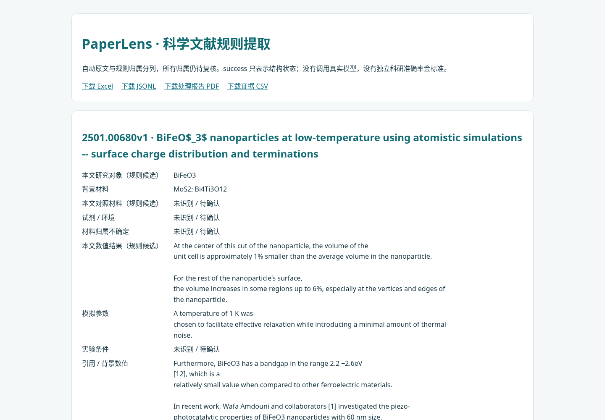
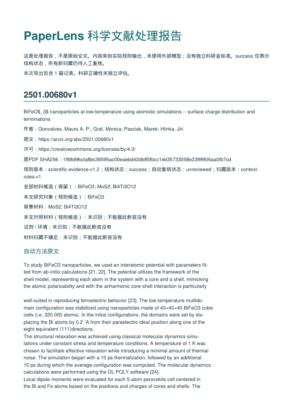

# PaperLens 材料角色与数值归属实测

日期：2026-11-17（Asia/Shanghai）。唯一仓库：takheichen59-bot/paperlens；开发分支：`codex/material-numeric-attribution`。基线 main 为 `092874a2899de87e646d91d0b3de1bb8a5b39f77`。

## 仓库与权限

先读取全部八份交接文档，并从对应PR分支读取工作流报告、浏览器说明、真实论文记录及过去式回归测试。公开GitHub页面的嵌入状态显示PR #1、#2均为OPEN，mergedTime=null；见[状态回执](pr-states.json)。main不含两者。新分支分别合入两PR，无冲突；没有合并main或改写历史。

认证检查实际失败：`gh auth status` / `gh api user`返回401，`git push --dry-run`因无可用Username失败。Git提交作者不等于认证账户；未假定继承DerekChen315授权，也没有要求切换仓库所有者账户。**新源码尚未上传、新PR未创建、新远端CI未执行。** 可连接有效GitHub账户后发布现有分支。

新工作区没有旧文献库文件。改动前对整合后的research代码做本地归档；全部测试和真实记录使用新目录。冻结的 `src/contracts/`、旧 `src/storage/` 及全部SQL与main相同。无用户数据库升级、覆盖或静默混用。

## 实现

- 保留PR #1的重复DOI规范化上传、失败项重试/检查点、选中导出、复核保留、方法/结论比较与CSP修复。
- 保留PR #2的过去式/完成式发现句与原文偏移修复。
- 新增 `context-roles-v1`：材料逐提及记录本文对象/背景/本文对照/试剂环境/不确定；数值记录本文结果/模拟参数/实验条件/引用背景/不确定。邻接的他人研究归属有上下文证据；明确转回本研究时重置归属。同句混合比较或参数/结果保留不确定。
- 原始材料、方法、发现、结论、公式、数值等均不静默改写。新角色层始终unreviewed。提取器版本升至 `scientific-evidence-v1.2`，旧指纹失效并保留历史；只导出的旧记录明确显示归属未执行。
- 六表Excel、追加列CSV、角色/数值/证据CSV、预览HTML及实际记录生成的处理报告PDF。JSONL保留原块、精确偏移和修订；旧 `results.jsonl` 格式不加入新字段。报告不是原始论文。
- 固定五篇公开CC-BY来源清单、调用真实平台获取器的下载脚本、真实文件一致性验证器和浏览器下载检查。没有上传私有论文、调用付费模型或部署服务。

## 重新运行的工程检查

| 检查 | 本轮实际结果 | 原始输出 |
|---|---|---|
| 单元/集成（包括9项新增归属测试） |54通过、0失败 |[final-unit.log](final-unit.log) |
| M01–M20及修复 |160 active checks；另3项变异、2项恢复检查通过 |[legacy.log](legacy.log) |
| 库历史/隔离/快照 |5通过 |[integrity.log](integrity.log) |
| 科研记录 / 情报验收 |各5通过 |[science.log](science.log)、[intelligence.log](intelligence.log) |
| 规则批次和5000合成任务终止/恢复 |5通过；SIGKILL后恢复24条，其余4976处理，0工程失败 |[research-batch.log](research-batch.log) |
| 新队列12合成任务进程恢复 |12完成、12 parse rows、0完成项重复 |[recovery.log](recovery.log) |
| Worker逻辑 |19/16/5项分别通过 |worker-site.log / worker-research.log / worker-integrity.log |
| 真实Chromium工作流（明确合成科研fixture） |12通过，0JS/CSP错误 |[browser-report.json](browser-report.json) |
| 真实在线来源浏览器冒烟 |5通过 |[live-browser-report.json](live-browser-report.json) |
| 真实交付预览及三种下载 |4检查通过，浏览器下载字节哈希一致 |[delivery-browser-report.json](delivery-browser-report.json) |
| 独立Excel/PDF读取 |openpyxl六表读取；核心单元格与JSONL一致；无公式单元格；PyMuPDF读取报告 |[independent-file-check.json](independent-file-check.json) |
| 精确上传候选源码扫描 |432文件、无所查密钥格式命中（最终源码候选快照） |[source-secret-scan.json](source-secret-scan.json) |

各套分别计数，不相加为科研准确率。在线浏览器冒烟是20条Crossref元数据，加独立的arXiv2501.00534v2一篇PDF，并非20篇全文。该深度提取仍为NOT_EXECUTED。

## 五篇真实PDF

本轮用真实 `OfficialSourceAcquirer` 再次下载5篇固定版本，逐篇核对当前CC BY4.0许可、原文哈希和PDF探测。见[acquisition.json](acquisition.json)、[acquisition.log](acquisition.log)。这是固定语料获取，不冒充检索召回评测，也不证明通用IP固定下载策略通过。

与真实旧基线（整合PR后、归属改动前）比较，5篇的原始字段完全相等；原证据文本、页码、偏移相等，仅新增解释证据及预期的策略版本变化。重新运行时5条均从检查点恢复、0重处理。见[real-validation.json](real-validation.json)、[resume-batch.log](resume-batch.log)。

| 原文 | 页数 | 规则结构状态 | 方法/发现/结论字符 | 本轮结果与缺口 |
|---|---:|---|---|---|
|2501.00680v1|11|success|1676 /134 /405|BiFeO3本文对象；MoS2与Bi4Ti3O12背景；引用数值3句、模拟参数1句、本文结果候选2句；55条精确证据切片 |
|2501.00561v1|9|success|2240 /494 /1312|Ga2O3本文对象；其他材料多数不确定；数值含实验条件、模拟参数、背景和混合归属，需复核 |
|2501.00591v1|7|partial|0 /811 /0|CrI3背景；NbSe2与CoI2不确定；非整数配方对象与方法/结论漏识别 |
|2501.00423v1|16|partial|0 /0 /174|HCl、ethanol为试剂；主要Cs2AgInCl6/Cs2NaInCl6未进入原材料候选；章节大段误标abstract，16条数值均保留不确定 |
|2501.00447v1|9|failed|0 /0 /0|量子物质观点文章，未提取到四核心字段；记录保留failed，不以少量算法提及填充 |

**批次processed=5、工程异常failed=0，不等于5篇内容成功：实际结构状态为2 success、2 partial、1 failed。** 全部仍未人工复核，无独立金标准。共233条来源切片验证，只证明字面来源一致。

## BiFeO3字段级前后对照

原PDF为6,027,220字节，SHA256 `1f88d96cfa8bc36595ac00eaebd42db85fbcc1eb35733058e2399906aa0fb7cd`，与用户交接一致。

| 字段 | 改进前 | 改进后 |
|---|---|---|
|材料候选|BiFeO3 / MoS2 / Bi4Ti3O12，没有角色|原列表保留；新增BiFeO3本文对象，后两者背景 |
|97%降解率|未解释归属的数值候选|引用/背景结果；保留第2页原句和前文Amdouni等人研究的归属证据 |
|1 K|未解释归属的数值候选|模拟参数；原文第4页 |
|约1%体积减小、最高6%体积增大|未解释归属的数值候选|本文结果候选；第4–5页，仍需复核 |
|方法|1676字符，第3–4页|逐字相同 |
|发现|134字符，第8页|逐字相同，不承诺完整 |
|结论|405字符，第8页|逐字相同 |
|证据|22条|原22条来源身份保留，新增33条角色/上下文证据，共55条 |
|复核|unreviewed|仍unreviewed |

单篇Excel含6表，单篇处理报告4页；5篇处理报告15页。已用独立文件读取器和真实Chromium下载核对，未声称在Microsoft Excel实机验证。

## 尚未验证与下一步

1. 先修复非整数/复杂化学式候选和章节识别，尤其00591、00423；不能把“有角色标签”当作材料识别完整。
2. 对上述5篇建立独立领域复核，逐句拆分混合数值、条件和比较。当前规则可能误判指代、跨块引用或章节边界。
3. 之后扩展20篇真实全文回归。本轮未执行20篇全文质量回归，不能以元数据数量替代。
4. 真实LLM/嵌入、GROBID/Docling、出版商授权、Windows、生产部署及独立科研准确率评估均未执行。

新规则只在research路径中生效；新版ScientificRecord工作区保持独立，未把规则结果伪装为模型输出。

历史失败与环境阻塞分别保留在[attempts.json](attempts.json)。指定附件输出目录在此云环境不可创建，文件保留于云工作区下载目录；这不是源码上传或部署完成。
