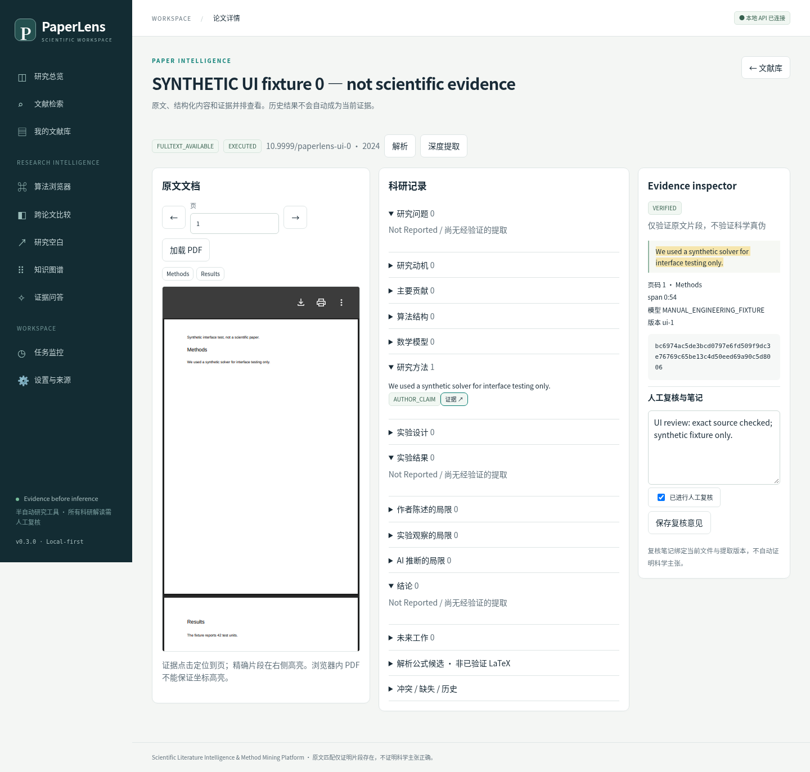
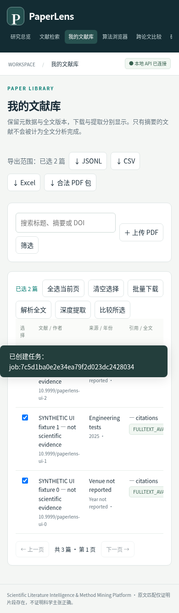
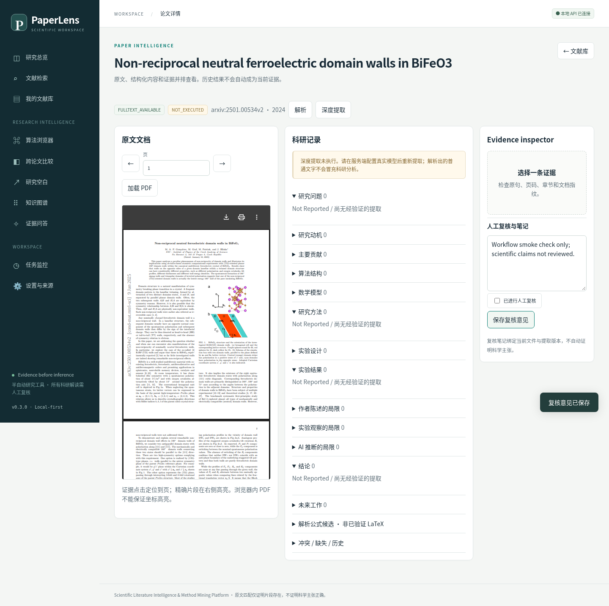

# Browser workflow repair and verification — 2026-11-17

Base: main `092874a2899de87e646d91d0b3de1bb8a5b39f77`. Branch: `codex/batch-workflow-e2e`.

The authenticated account was rechecked as DerekChen315 with push permission to takheichen59-bot/paperlens. All eight handoff documents were read. Code backup: local ignored `work/browser-baseline/before-code.tar.gz`; tests use new temporary databases and leave personal data untouched. Frozen contracts, old storage and all SQL schemas are unchanged.

## Fixed behaviors

- Duplicate DOI uploads use the server's canonical paper ID; normalized DOI URLs/case no longer lead to uploading under a nonexistent ID.
- Corrupt/moved source files can be replaced through upload; an existing same-hash document now updates its valid local path.
- Completed batches with failed papers expose retry; only failed checkpoints are requeued. Completed successes remain committed. Failed discovery sources can also be reset for explicit retry.
- Select/clear the visible page, show the export scope and apply selected IDs to JSONL/CSV/Excel/PDF exports. Invalid selections are rejected instead of falling back to the whole library.
- Current review notes/revisions are included in the same export read transaction. The checked review box survives page reloads. Spreadsheets expose identifiers and readable method/conclusion/result columns alongside nested records; blank cells remain blank and leading-whitespace formulas are escaped.
- Comparison includes methodology/conclusions; compare, compare-export and gaps reject missing selected extractions instead of silently dropping papers.
- Inline styles were moved to CSS, retaining the restrictive CSP. Favicon404 is removed. Requests superseded by navigation no longer replace the newer route.

## Actual results

- Browser: Chromium156.0.8078.79, Playwright1.62.0, Linux.
- Deterministic Chromium suite: **12 passed**, using real API/SQLite/PDF handling and explicitly labelled synthetic engineering records. No uncaught JavaScript/CSP violations. [Receipt](fixture-report.json).
- Real upstream suite: **5 passed**. Crossref query `materials science computational` returned20 actual stored records. Separately, arXiv2501.00534v2 was downloaded, parsed into32 segments, annotated with a workflow-only note, and exported through the browser. [Receipt](live-report.json).
- Real PDF:3,702,933 bytes; SHA256 `b979aebce79a4f1c4afb24dc6087c2dc0cc5e7c5d9a5bdec7e112c3153c19a77`. The bytes match the previously CC-BY4.0-verified version. This is one real PDF, not20 real fulltexts or an extraction-quality corpus.
- The real record correctly remains **NOT_EXECUTED** for deep extraction. No scientific claim was generated or certified.
- API/unit regression: **42 passed** (30 existing +12 workflow repair cases). Legacy checks: **160 passed**, plus existing mutation/recovery checks. A separate12-item SIGKILL/resume check completed with12 parse rows and no duplicate completed work. Outputs are retained beside this report. Historical failed attempts and their actual causes are in [attempts.json](attempts.json); no failure was re-labelled as an expected pass.

## Screenshots actually captured and inspected

Synthetic source evidence / review:

Selected exports at mobile width:

Real arXiv document with no-model state:

## Scope and remaining gaps

The suite checks one Chromium desktop engine and a mobile viewport, not a real phone, all browsers or production hosting. Native PDF fragment/page controls are checked, not pixel-exact native scrolling or bbox overlays. Real-model/NER accuracy, independent human gold, dual-parser science quality, publisher authorization,20-paper real acquisition batches and5000-paper throughput remain unverified. The existing Worker site is not modified or deployed.

Reproduce using [tests/browser/README.md](../../../tests/browser/README.md). The deterministic suite is now included as a separate GitHub Actions job; live upstream checks remain opt-in to avoid external outages being confused with deterministic regressions.
